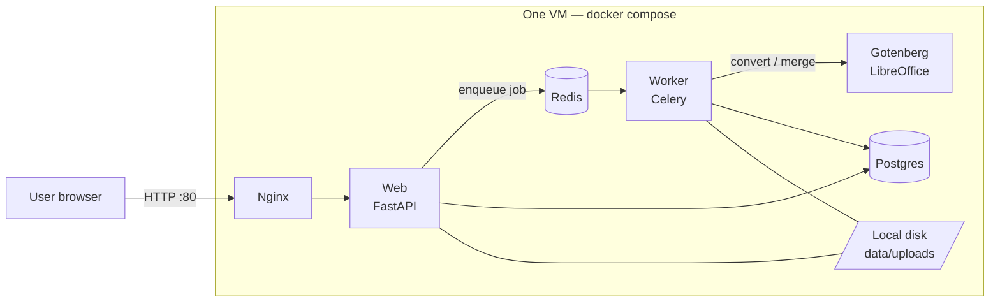

# DocFlow

A small-business document tool: convert Word, Excel, PowerPoint, text and image files to PDF, and merge PDFs. Users sign up, upload files, and download the results from their history.

DocFlow is the subject of a **cloud migration case study**. It ships first as a typical "everything on one server" deployment (this repo, Phase 1), then gets migrated to a scalable, secure AWS architecture with Terraform (Phase 2).

---

## Phase 1: Legacy architecture (single server)



| Component | Role |
|---|---|
| **Web** (FastAPI) | Accounts, uploads, job history, downloads, `/healthz` |
| **Worker** (Celery) | Picks jobs off the queue, calls Gotenberg, saves the PDF; retries with backoff if Gotenberg is down |
| **Gotenberg** | Open-source conversion engine (LibreOffice + PDF tools) in a container |
| **Postgres** | Users and job records (files are *not* stored in the DB) |
| **Redis** | Job queue |
| **Local disk** | Uploaded and generated files, shared by web and worker |

### Why this needs migrating

This setup works, and it's how a lot of real businesses run. These are its problems, and each one is fixed in Phase 2:

| Problem | Impact | Phase 2 fix |
|---|---|---|
| Single server | Any crash, reboot or disk failure takes the whole product down | Multi-AZ ECS Fargate behind an ALB |
| Files on local disk, shared by web and worker | Can't run a second server; disk fills up; files lost if the VM dies | S3 with lifecycle rules + presigned URLs |
| Database on the same box | No automated backups, no failover, competes with the app for CPU/RAM | RDS PostgreSQL with automated backups |
| Conversions compete with the website for CPU | A burst of uploads slows down every page | Separate worker service that autoscales on queue depth |
| Secrets in a `.env` file on the server | Anyone with SSH sees every password | AWS Secrets Manager, injected at runtime |
| Manual backups (`scripts/backup.sh`) stored on the same server | Backups depend on someone remembering, and die with the server | AWS Backup / RDS snapshots, cross-region copy |
| Deploys by SSH + `git pull` | Risky, slow, no rollback | GitHub Actions → ECR → ECS with OIDC (no stored keys) |
| No HTTPS, no monitoring | Credentials sent in clear text; outages found by customers | ACM certificate on ALB/CloudFront; CloudWatch alarms |
| Downloads stream through the app server | Large files tie up web workers | Redirect to short-lived S3 presigned URLs |

The code is already prepared for the move: all config comes from environment variables, storage sits behind one small interface (`app/storage.py`), the web and worker share an image, and there's a health check endpoint for the load balancer.

---

## Run it

### With Docker (the legacy deployment)

```bash
cp .env.example .env        # then edit the passwords and SECRET_KEY
docker compose up -d --build
```

Open http://localhost, create an account, and convert something. Check on things with:

```bash
docker compose ps
docker compose logs -f worker
curl localhost/healthz
```

Back up (the legacy way):

```bash
./scripts/backup.sh
```

### Without Docker (quick local development)

You still need Gotenberg for real conversions (`docker run -p 3000:3000 gotenberg/gotenberg:8`).

```bash
python -m venv .venv && source .venv/bin/activate
pip install -r requirements-dev.txt
export CELERY_EAGER=true        # run jobs inline, no Redis needed
uvicorn app.main:app --reload
```

This uses SQLite and stores files in `./data/uploads`.

### Tests

```bash
pip install -r requirements-dev.txt
pytest
```

The tests cover sign-up and login, convert and merge flows, file-type and size validation, merge ordering, one user being unable to reach another's files, failed conversions, deletion, and filename sanitising. Gotenberg is mocked, so they run anywhere.

---

## Project layout

```
app/
  main.py        routes: auth, convert, merge, status, download, delete, /healthz
  worker.py      Celery app + process_job task (retries, failure handling)
  gotenberg.py   conversion client
  storage.py     file storage (LocalStorage now, S3Storage after migration)
  models.py      User, Job
  db.py          SQLAlchemy engine/session, health check
  auth.py        bcrypt password hashing
  config.py      settings from environment variables
  templates/     Jinja2 pages
  static/        CSS
tests/           pytest suite
nginx/           reverse proxy config
scripts/         backup.sh
docker-compose.yml, Dockerfile, .env.example
```

---

## Roadmap

- [x] **Phase 1:** App + legacy single-server deployment
- [ ] **Phase 2:** Migrate to AWS with Terraform (VPC, ECS Fargate, RDS, S3, SQS, ALB, ACM, Secrets Manager, CloudWatch) + migration runbook
- [ ] **Phase 3:** CI/CD with GitHub Actions and OIDC
- [ ] **Phase 4:** Security audit (Prowler / CIS benchmark) and hardening, with before/after scores
- [ ] **Phase 5:** Cost comparison (VM vs AWS) and optimisation
- [ ] **Phase 6:** Monitoring, alerting and disaster recovery drill
