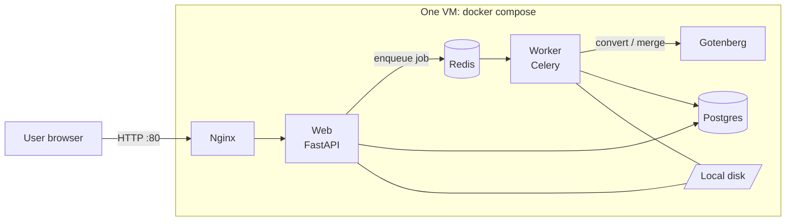
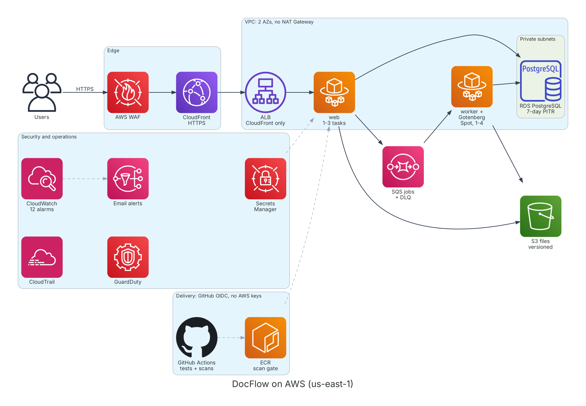

# DocFlow: moving a single-server app to AWS with Terraform

[](https://github.com/cybern3m3/docflow/actions/workflows/ci.yml)
[](https://codespaces.new/cybern3m3/docflow)

**DocFlow** is a document-to-PDF web app (convert Word, Excel, PowerPoint, text and images; merge PDFs) that I built, deployed the way many small businesses do (everything on one server), and then **migrated to AWS with Terraform**. Along the way I hardened, costed, monitored and DR-tested it.

| | Result |
| --- | --- |
| **Migration** | 5 users, 21 jobs and 21 files moved with **zero data loss**, verified automatically; **~9 minutes** of downtime ([runbook](docs/migration-runbook.md)) |
| **Infrastructure** | **101 AWS resources, all Terraform**, in 7 modules plus a long-lived bootstrap layer; rebuilt from code in about 15 minutes and destroyed after every session |
| **Security** | Checkov findings **51 → 0** (6 fixed, 45 accepted with written reasons); account audited with Prowler (CIS AWS benchmark) and every remaining finding triaged; WAF, CloudTrail, GuardDuty, flow logs, read-only containers; no AWS keys anywhere ([security](docs/security.md)) |
| **Delivery** | Every change tested, scanned (secrets, IaC, dependencies, image CVEs), previewed as a Terraform plan, deployed with automatic rollback, then smoke-tested |
| **Cost** | Always-on AWS **$105 → $82/month (−22%)** with Fargate Spot; **~$4.50/month** as run here ([cost analysis](docs/cost-analysis.md)) |
| **Operations** | 12 alarms, event alerts and a dashboard. DR drills passed: **database restored in ~15 min with zero data loss**, deleted file recovered in 4 s, a crashed task healed automatically ([operations](docs/operations.md), [DR](docs/disaster-recovery.md)) |

---

## The problem

The original deployment runs six containers on one VM with Docker Compose: Nginx, the FastAPI web app, a Celery worker, Gotenberg (LibreOffice), PostgreSQL and Redis.



| Problem | Impact |
| --- | --- |
| Single server | Any crash, reboot or disk failure takes the whole product down |
| Database and files on the same disk; backups by hand | One bad disk loses everything |
| Conversions compete with the website for CPU | A burst of uploads slows every page |
| Secrets in a `.env` file; no HTTPS; no firewall | Anyone with SSH sees every password; logins sent in clear text |
| Deploys by SSH and `git pull`; no monitoring | Risky deploys; outages found by customers |

## The solution



<sub>Diagram as code: `scripts/diagram/architecture.py`</sub>

| Legacy problem | AWS design |
| --- | --- |
| Single server | Fargate tasks behind an ALB across two AZs; ECS replaces failed tasks; deployments roll back automatically |
| Files on local disk | S3 with versioning and lifecycle rules; downloads are 5-minute presigned links |
| Database on the same box | RDS PostgreSQL: private, encrypted, TLS required, 7-day point-in-time recovery |
| Conversions compete with the website | Separate worker service that scales on queue depth, on Fargate Spot |
| Secrets in `.env` | Secrets Manager, injected at start-up; RDS-managed rotating password |
| No HTTPS, no firewall | CloudFront HTTPS + AWS WAF; ALB accepts CloudFront only |
| SSH deploys | GitHub Actions → ECR (scan gate) → ECS, with OIDC roles scoped to `main` and PRs |
| No monitoring | CloudWatch alarms, event alerts and a dashboard |

**One image, two environments:** the same Docker image runs on the legacy server and on AWS. Only environment variables change (storage `local`/`s3`, broker Redis/SQS, database settings).

## Key decisions and trade-offs

| Decision | Why | Trade-off |
| --- | --- | --- |
| **No NAT Gateway**: tasks in public subnets with public IPs | Saves ~$66/month (two AZs) | Tasks have public IPs; security groups block all inbound except the ALB |
| **CloudFront in front of the ALB** | Free HTTPS without a custom domain, edge caching, WAF attachment point | The origin hop is HTTP (documented as an accepted risk; production would add a domain and TLS to the origin) |
| **ECS Fargate**, not EKS or EC2 | No servers or cluster to manage for two services | Less control than EC2; EKS would be overkill |
| **SQS** instead of managed Redis | Serverless, nearly free, with a built-in dead-letter queue | Celery's SQS transport has fewer features than Redis |
| **Worker on Fargate Spot** | ~65% cheaper; jobs are idempotent and `acks_late` re-queues interrupted ones | Possible 2-minute interruptions (alerted, auto-replaced) |
| **Destroy after every session** | A portfolio environment shouldn't cost money while idle | 15-minute rebuild; data doesn't persist between sessions |
| **Accepted risks written in the code** (`#checkov:skip=...:reason`) | Every exception is reviewed in a PR and the build fails on anything new | Requires discipline to keep the reasons true |

## Results

### Migration ([runbook](docs/migration-runbook.md))

Exported the database, copied the files to S3, restored the data inside the VPC with a one-off Fargate task (the database is never exposed), then verified users, jobs per status and every finished file automatically.

| Users | Jobs | Files | Data lost | Downtime |
| --- | --- | --- | --- | --- |
| 5 → 5 | 21 → 21 | 21 → 21 | **0** | **~9 min** |

### Security ([details](docs/security.md))

| | Before | After |
| --- | --- | --- |
| Checkov IaC findings | 51 failed | **0 failed** (6 fixed, 45 accepted with reasons) |
| Prowler, CIS AWS benchmark 7.0 (whole account) | 60.6% | **63.5%** (the rest: [explained](docs/security.md#4-audit-results)) |
| Container image (ECR scan) | 0 critical, 3 high | 0 critical, 3 high: no Debian fix yet, none reachable by the app ([triaged](docs/security.md#container-image-amazon-ecr-scan)) |

STRIDE threat model, defence in depth from edge to account, CI security gates (Gitleaks, Checkov, pip-audit, ECR scan gate), and an incident runbook.

### Cost ([details](docs/cost-analysis.md))

| Legacy VM | AWS always on, before | AWS always on, after | AWS as run here (40 h/month) |
| --- | --- | --- | --- |
| $24 | $105 | **$82** | **~$4.50** |

AWS costs more than one VM. The difference buys redundancy, managed backups, scaling, a WAF and zero servers to patch. The cost analysis says when that's worth it, and when it isn't.

### Reliability ([DR plan](docs/disaster-recovery.md))

| Drill | Result |
| --- | --- |
| Database point-in-time restore | **Passed**: all data identical; RPO 8 min 35 s, RTO ~15 min (target 1 hour) |
| Deleted file recovered from S3 versioning | **Passed**: byte for byte in 4 s |
| Web task killed | 1 task: ~28 s of errors, alarm emailed, healed automatically · 2 tasks: **no outage** |

## Problems I hit and how I fixed them

Real issues from building and running this project, each traced to a root cause and fixed in code:

| Symptom | Root cause | Fix |
| --- | --- | --- |
| First AWS deploy returned **HTTP 503** | The image tag `yes` had been typed into Terraform's `image_tag` prompt | Derive the tag from Git (`git rev-parse --short`), so it can't be typed wrong |
| GitHub Actions couldn't assume its AWS role | GitHub's 2026 OIDC token format includes immutable owner and repo IDs, so the trust policy never matched | Trust policies match the immutable IDs, which also stops a renamed or re-created repo from inheriting access |
| Proxy kept sending traffic to a dead container after a rebuild | nginx resolved the container's address once, at start-up | Resolve through Docker DNS every 10 seconds |
| A unit test failed on S3 download links | The links were signed with deprecated Signature Version 2 | Force SigV4 before any code reached AWS |
| Deploy failed with `Service is DRAINING` | A merge landed while `terraform destroy` was running; the pipeline only checked the cluster | Deploy only when both services are ACTIVE |
| Switching the worker to Fargate Spot failed on the live service | AWS needs a new deployment when a running service changes capacity provider | `force_new_deployment = true`, caught by the PR's plan against real state |
| DR drill reported "no data" from the restored database | The script read CloudWatch Logs before the task's output arrived | Wait for the expected output line (up to 60 s) |
| Turning on the account-wide S3 public block would have taken other projects offline | The AWS account is shared with older projects that serve public buckets | Checked the blast radius first; made the setting switchable and documented the exception |

## CI/CD

```
Pull request:  unit tests → end-to-end (full Docker stack) → terraform fmt/validate/test
               → security scans (Gitleaks, Checkov, pip-audit) → terraform plan posted as a comment
Merge to main: the same checks → build image (tag = commit) → push to ECR → scan gate (blocks CRITICAL)
               → deploy web + worker (waits for healthy, rolls back if not) → smoke test the live site
```

| Role | Can be assumed by | Allowed to |
| --- | --- | --- |
| `docflow-github-deploy` | Workflows on `main` of this repo only (immutable repo ID) | Push DocFlow images, register task definitions, update the two services |
| `docflow-github-plan` | Pull-request workflows of this repo only | Read the Terraform state and plan lookups. No data, files or secrets |

`terraform apply` stays manual from a codespace: a deliberate cost-control decision for an environment that is destroyed after every session.

## Repository map

```
app/                 FastAPI web app, Celery worker, storage (local/S3), migration CLI
infra/               Terraform: network, storage, queue, database, edge (CloudFront, ALB, WAF),
                     compute (ECS), monitoring; tests/ = offline plan with mock providers
infra/bootstrap/     Long-lived layer: state bucket, ECR, GitHub OIDC roles, account security baseline
scripts/             e2e.sh, push-image.sh, migrate/, security/prowler-scan.sh, cost/estimate.py, dr/,
                     diagram/architecture.py (the architecture diagram, as code)
docs/                migration runbook, security, cost analysis, operations, disaster recovery,
                     architecture/, evidence/ (screenshots)
.github/             CI/CD workflow, Dependabot
```

## Run it

**Legacy stack, in GitHub Codespaces** (nothing to install): click **Code → Codespaces → Create codespace**, then:

```bash
docker compose up -d --build
./scripts/e2e.sh            # full end-to-end test against the running stack
```

Open the **Ports** tab → port 80. Tests: `pip install -r requirements-dev.txt && pytest`.

**AWS** (from a codespace signed in with `aws sso login`):

```bash
export TF_VAR_image_tag=$(git rev-parse --short origin/main)   # the image CI built
export TF_VAR_alert_email=you@example.com                      # optional: alarm emails
cd infra
terraform plan -out tfplan && terraform apply tfplan           # about 15 minutes
../scripts/e2e.sh "$(terraform output -raw app_url)"
terraform destroy                                              # at the end of every session
```

## Roadmap

- [x] **Phase 0–1:** App, legacy single-server deployment, secured AWS account (MFA, budget alerts, SSO with no access keys)
- [x] **Phase 2:** Terraform foundations: encrypted, versioned state bucket with native locking
- [x] **Phase 3:** Network and data: VPC without a NAT Gateway, S3, SQS with dead-letter queue, private RDS, Secrets Manager, ECR
- [x] **Phase 4:** Cloud-ready app: S3 storage with presigned downloads, SQS broker, database settings from Secrets Manager
- [x] **Phase 5:** ECS Fargate (web + worker with Gotenberg sidecar), ALB reachable only through CloudFront, autoscaling
- [x] **Phase 6:** The migration: zero data loss, ~9 minutes of downtime
- [x] **Phase 7:** CI/CD with GitHub Actions and OIDC: plan previews, scan-gated deploys, smoke tests
- [x] **Phase 8:** Security: threat model, WAF, account baseline, CI security gates, Checkov 51 → 0, Prowler audit
- [x] **Phase 9:** Cost analysis and optimisation: Fargate Spot (−22%)
- [x] **Phase 10:** Monitoring, alerting and disaster recovery drills
- [x] **Phase 11:** Case study write-up

**Next:** custom domain with TLS to the origin, Multi-AZ database, cross-region backups, Graviton (ARM64) images, and actions pinned to commit SHAs.

## Evidence

All screenshots are in [`docs/evidence/`](docs/evidence/).

| Phase | Screenshot |
| --- | --- |
| 0 Legacy stack | [Six containers running](docs/evidence/phase0-compose-ps.png) · [The app](docs/evidence/phase0-dashboard.png) · [First green CI](docs/evidence/phase0-ci-green.png) |
| 3 Network and data | [VPC: public and private subnets, S3 endpoint, no NAT](docs/evidence/phase3-vpc-resource-map.png) · [RDS: private, no internet access](docs/evidence/phase3-rds-private.png) |
| 5 Running on AWS | [App live on CloudFront HTTPS](docs/evidence/phase5-app-on-aws.png) · [End-to-end test passing on AWS](docs/evidence/phase5-e2e-aws.png) |
| 6 Migration | [Counts verified: zero data loss](docs/evidence/phase6-migration-verified.png) |
| 7 CI/CD | [Pipeline green: test → build → scan → deploy](docs/evidence/phase7-pipeline-green.png) |
| 8 Security | [Prowler before](docs/evidence/phase8-prowler-before.png) · [Prowler after](docs/evidence/phase8-prowler-after.png) · [WAF blocking an attack in the CI smoke test](docs/evidence/phase8-waf-blocked.png) |
| 10 Monitoring and DR | [Dashboard](docs/evidence/phase10-dashboard.png) · [Alarm email: ALARM then OK](docs/evidence/phase10-alarm-email.png) · [Database restore drill passed](docs/evidence/phase10-db-restore-drill.png) |
| Interface (live on AWS) | [Guest mode: try it without an account](docs/evidence/ui-live-guest.png) · [Converted files ready to download](docs/evidence/ui-live-files.png) · [On a phone](docs/evidence/ui-live-phone.png) |
